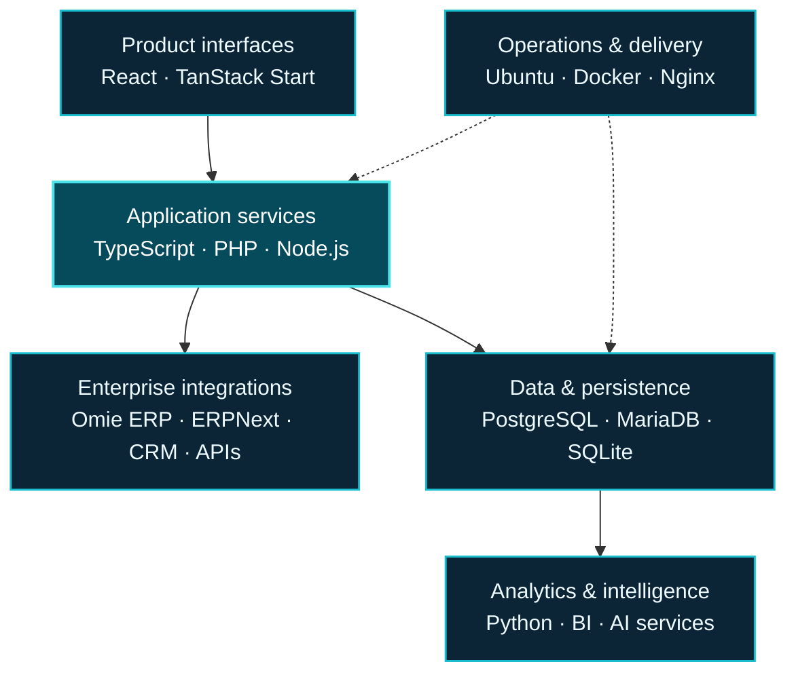

  

  
  
  

  

  **Engineering software that makes complex operations simpler.**

---

## 👨‍💻 About me

I'm **Vladson Santos Bezerra**, a software developer based in Fortaleza, Brazil. I design, build, integrate, and operate business-focused applications — from customer-facing experiences and internal platforms to data pipelines, enterprise integrations, and production infrastructure.

My work brings together **software architecture, full-stack development, automation, business intelligence, and AI**. I enjoy connecting the technical details to the real problem: reliable systems, trustworthy data, and practical results for the people who use them.

- 🧩 **Build:** Web platforms, back-end services, internal tools, and modular software systems.
- 🔗 **Connect:** ERP/CRM ecosystems, REST APIs, business workflows, and external services.
- 📊 **Understand:** Operational data, analytics, data quality, dashboards, and forecasting.
- 🛠️ **Operate:** Linux servers, containers, deployment workflows, monitoring, and recovery.
- 🤖 **Explore:** Local language models, AI integrations, and intelligent automation.

> **What guides my work:** clear architecture, data integrity, security by design, maintainability, and safe deployments.

---

## ⚡ Technology landscape

**Languages & interfaces**

**Services, data & infrastructure**

**Also working with:** TanStack Start · MariaDB · SQL · REST APIs · PostgREST · n8n · ERPNext / Frappe · Omie ERP · Ollama · LLM integrations · WordPress (headless CMS)

---

## 🚀 Selected projects

These repositories document **real engineering work**, including product implementation, systems integration, technical decisions, and operating software beyond initial deployment.

| Enterprise platforms | Infrastructure, automation & integrations |
|:--|:--|
| **[📊 BIOMIE v2](https://github.com/bvladson/biomie-v2)** Business intelligence platform for multiple companies, with analytics, inventory intelligence, financial views, and Python services. `TypeScript` `React` `PostgreSQL` `Python` | **[⚙️ Ubuntu VPS Infrastructure](https://github.com/bvladson/infra-vps-ubuntu)** Production infrastructure patterns, container operations, secure deployments, health checks, backups, and rollback procedures. `Linux` `Docker` `Nginx` `Bash` |
| **[🌐 MAG Website + CRM](https://github.com/bvladson/mag-site-crm)** Corporate website and commercial workspace: catalog, CRM, sales workflows, proposals, and ERP/WhatsApp integration. `React` `TypeScript` `SQLite` | **[🤖 MAG AI](https://github.com/bvladson/mag-ai)** Local language model infrastructure, internal gateway, isolation, validation, and enterprise AI integration. `Ollama` `Node.js` `Docker` |
| **[🏗️ BIOMIE v1](https://github.com/bvladson/biomie-v1)** First-generation PHP business intelligence system, with modular application layers, integration contracts, and data governance. `PHP 8` `MariaDB` `Nginx` | **[🔧 ERPNext Brazilian Localization](https://github.com/bvladson/vsb-erp-ptbr)** Portuguese (Brazil) document and print templates, with validation of real PDF output. `ERPNext` `Frappe` `Jinja` |
| **[🗂️ MAG Base](https://github.com/bvladson/mag-base)** Enterprise task management customization, localization, scripted releases, and validation. `PHP` `MariaDB` `Python` | **[🏢 VSB Corporate Website](https://github.com/bvladson/vsb-site-institucional)** Business site with headless content management, lead capture, and automated production audits. `TypeScript` `React` `WordPress` |

**[Explore my repositories →](https://github.com/bvladson?tab=repositories)**

---

## 🧠 How I approach systems

Across my projects, I work with patterns like this. **This is an illustrative view of my technical areas, not a deployment diagram of one application.**

### Engineering principles

`Security by design` · `Reliable data` · `Automation-first operations` · `Observable systems` · `Safe release processes` · `Maintainable architecture`

---

## 🎓 Education

| Qualification | Institution | Focus |
|:--|:--|:--|
| **Undergraduate degree — Business Intelligence** | University of Fortaleza (UNIFOR), Brazil | Data analysis, analytics, and decision intelligence |
| **Degree — Marketing** | Estácio University, Brazil | Business strategy, market analysis, and digital business |
| **Executive MBA — Marketing** | Faculdade CDL, Brazil | Strategic management, leadership, and business performance |

My academic background complements hands-on engineering with **analytical reasoning and a practical understanding of business operations**.

---

## 🌎 Connect

**Have an interesting engineering challenge or want to talk about systems, data, or automation?**

Fortaleza, Ceará, Brazil · Building systems that connect software, data, and people.

